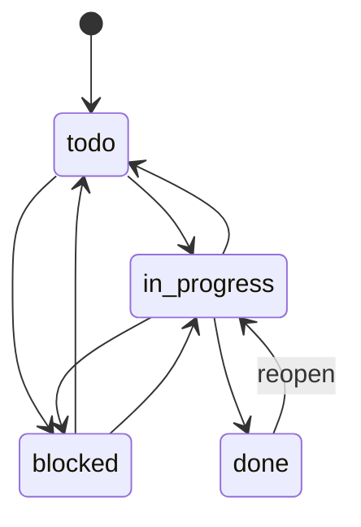
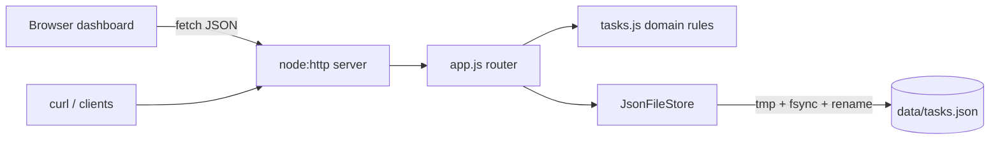

# TaskFlow API

A small but complete task-management service: a JSON REST API with validated
status transitions, filtering/sorting/pagination, live metrics, optimistic
concurrency, durable file persistence with atomic writes, and a self-contained
HTML dashboard served by the same Node process.

**Zero runtime or dev dependencies** — only Node.js built-ins (`node:http`,
`node:fs`, `node:crypto`, `node:test`).

- Default URL: <http://127.0.0.1:3001> (dashboard) — API under `/api`
- Requires Node.js **18.18+** (Node 20 LTS recommended)

---

## Quick start

```powershell
cd taskflow-api
npm start                 # http://127.0.0.1:3001
npm test                  # runs the node:test suite against real HTTP endpoints
npm run dev               # auto-restart on file changes (node --watch)
```

Override settings with environment variables (see `.env.example`):

```powershell
$env:PORT=4001; $env:DATA_FILE="C:\temp\tasks.json"; npm start   # PowerShell
PORT=4001 DATA_FILE=/tmp/tasks.json npm start                       # bash
```

| Variable | Default | Description |
|---|---|---|
| `HOST` | `127.0.0.1` | Bind address. Localhost-only by default. |
| `PORT` | `3001` | Listen port. |
| `DATA_FILE` | `data/tasks.json` | JSON data file; relative paths resolve from project root. Created on first start. |
| `BODY_LIMIT_BYTES` | `65536` | Maximum request body size (413 if exceeded). |
| `REQUEST_TIMEOUT_MS` | `15000` | Max time to receive a full request. |
| `LOG_REQUESTS` | `true` | One-line JSON access log per request on stdout. |

Invalid configuration aborts startup with a clear message.

---

## Domain model

```jsonc
{
  "id": "6f1c…-uuid",            // server-generated UUID v4
  "title": "Write docs",         // required, 1–200 chars (trimmed)
  "description": "",             // 0–2000 chars
  "status": "todo",              // todo | in_progress | blocked | done
  "priority": "medium",          // low | medium | high
  "assignee": null,              // 1–100 chars or null
  "dueDate": "2026-03-20",       // valid calendar date YYYY-MM-DD, or null
  "tags": ["docs"],              // ≤10 unique tags matching ^[a-z0-9][a-z0-9-]{0,29}$
  "createdAt": "…ISO…", "updatedAt": "…ISO…",
  "completedAt": null,           // set when moved to done, cleared when reopened
  "version": 1,                  // increments on every update (used for If-Match)
  "overdue": false               // computed: dueDate < today (UTC) and status != done
}
```

### Status transitions

New tasks always start as `todo`. Allowed moves:



Any other move returns **409 `invalid_transition`** with the allowed targets.

---

## API contract

All responses are JSON (`application/json; charset=utf-8`) except the dashboard
and `204` responses. Request bodies must use `Content-Type: application/json`.

Success envelope: `{ "data": … }` (lists add `"page": { total, limit, offset }`).
Error envelope:

```json
{ "error": { "code": "validation_error", "message": "Invalid task payload",
             "details": [{ "field": "title", "message": "is required" }] } }
```

| Method | Path | Description | Success |
|---|---|---|---|
| GET | `/` | HTML dashboard | 200 |
| GET | `/health` | Liveness + task count | 200 |
| GET | `/api/meta` | Statuses, priorities, transition map | 200 |
| GET | `/api/tasks` | List/filter/sort/paginate tasks | 200 |
| POST | `/api/tasks` | Create task | 201 + `Location`, `ETag` |
| GET | `/api/tasks/:id` | Fetch one task | 200 + `ETag` |
| PATCH | `/api/tasks/:id` | Partial update / status transition | 200 + `ETag` |
| DELETE | `/api/tasks/:id` | Delete task | 204 |
| GET | `/api/metrics` | Aggregate metrics | 200 |

### List query parameters (`GET /api/tasks`)

| Param | Example | Notes |
|---|---|---|
| `status` | `todo,in_progress` | Comma list of statuses |
| `priority` | `high` | Comma list of priorities |
| `assignee` | `ana` | Case-insensitive exact match |
| `tag` | `docs` | Task must contain tag |
| `q` | `deploy` | Case-insensitive search in title/description (≤100 chars) |
| `overdue` | `true` / `false` | Computed overdue flag |
| `sort` | `-createdAt` (default) | `createdAt`, `updatedAt`, `dueDate`, `priority`, `title`; prefix `-` for descending. `null` due dates sort last. |
| `limit` | `50` | 1–100 |
| `offset` | `0` | ≥0 |

Unknown parameters or invalid values → **400**.

### Optimistic concurrency

`GET`/`POST`/`PATCH` return `ETag: "<version>"`. Send `If-Match: "<version>"`
on `PATCH`/`DELETE` to reject lost updates with **412 `version_mismatch`**.
The header is optional.

### Metrics (`GET /api/metrics`)

```json
{ "data": { "total": 3, "byStatus": { "todo": 2, "in_progress": 0, "blocked": 0, "done": 1 },
  "byPriority": { "low": 1, "medium": 1, "high": 1 }, "overdue": 1, "dueNext7Days": 1,
  "unassigned": 2, "completionRate": 0.333, "avgCycleTimeHours": 4.5, "generatedAt": "…" } }
```

`avgCycleTimeHours` = mean of `completedAt − createdAt` over done tasks (`null` if none).

### Error codes

| HTTP | code | When |
|---|---|---|
| 400 | `validation_error` | Bad fields, unknown fields, bad query params, empty body |
| 400 | `invalid_json` | Body is not parseable JSON |
| 404 | `not_found` | Unknown route or task id |
| 405 | `method_not_allowed` | Wrong method (includes `Allow` header) |
| 409 | `invalid_transition` | Disallowed status change |
| 412 | `version_mismatch` | `If-Match` does not match current version |
| 413 | `payload_too_large` | Body exceeds `BODY_LIMIT_BYTES` |
| 415 | `unsupported_media_type` | Body not sent as `application/json` |
| 500 | `internal_error` | Unexpected failure (details logged server-side only) |

---

## curl examples

(On Windows PowerShell use `curl.exe` and escape quotes, or run from Git Bash/WSL.)

```bash
BASE=http://127.0.0.1:3001

# Create
curl -s -X POST $BASE/api/tasks -H 'Content-Type: application/json' \
  -d '{"title":"Ship v1","priority":"high","assignee":"ana","dueDate":"2026-12-01","tags":["release"]}'

# List high-priority open tasks, soonest due first
curl -s "$BASE/api/tasks?status=todo,in_progress&priority=high&sort=dueDate"

# Overdue tasks / text search / pagination
curl -s "$BASE/api/tasks?overdue=true"
curl -s "$BASE/api/tasks?q=ship&limit=10&offset=0"

# Transition with optimistic concurrency
curl -s -X PATCH $BASE/api/tasks/<id> -H 'Content-Type: application/json' \
  -H 'If-Match: "1"' -d '{"status":"in_progress"}'

# Invalid transition (todo -> done) => 409
curl -s -X PATCH $BASE/api/tasks/<id> -H 'Content-Type: application/json' -d '{"status":"done"}'

# Clear assignee and due date
curl -s -X PATCH $BASE/api/tasks/<id> -H 'Content-Type: application/json' -d '{"assignee":null,"dueDate":null}'

# Delete, metrics, health
curl -s -X DELETE $BASE/api/tasks/<id> -o /dev/null -w '%{http_code}\n'
curl -s $BASE/api/metrics
curl -s $BASE/health
```

---

## Dashboard

Open <http://127.0.0.1:3001>. It shows metric cards, a status distribution
chart, a create form, filters (status/priority/search/overdue/sort), and a
task table with one-click buttons for every **allowed** transition (sent with
`If-Match`) plus delete. The page is a single static file (`public/index.html`)
with no external assets, fonts, or CDNs.

---

## Architecture

```
src/
  server.js   entrypoint: config, listen, graceful shutdown (SIGINT/SIGTERM)
  config.js   env parsing + validation
  app.js      routing, handlers, request logging (createApp() is used by tests)
  tasks.js    domain: validation, transitions, filtering/sorting, metrics
  store.js    JsonFileStore: in-memory state + serialized atomic persistence
  http.js     JSON/HTML responses, body parsing w/ limits, error types, security headers
public/index.html   dashboard (vanilla JS, no deps)
tests/api.test.js   node:test suite over real HTTP
```



## Data persistence

- State is loaded from `DATA_FILE` at startup (created if missing) and served from memory.
- Every mutation runs through a **single serialized queue**: the handler
  computes a new immutable document, which is written to a unique temp file in
  the same directory, `fsync`ed, then atomically `rename`d over the data file.
  Memory is updated **only after** the write succeeds, so a failed write never
  leaves the API and the file out of sync. A crash mid-write leaves the
  previous complete file intact (a stray `*.tmp` may remain and is safe to delete).
- Windows transient `EPERM/EBUSY` on rename (antivirus/indexers) is retried briefly.
- If the data file is corrupt or has the wrong shape the service **refuses to
  start** instead of silently overwriting it.
- Backup: copy the JSON file (writes are atomic, so any copy is consistent).
- Scope: designed for a single process and thousands of tasks. Running multiple
  instances against one file is **not** supported; move to SQLite/Postgres for
  that.

## Security

- Binds to `127.0.0.1` by default; no authentication is built in — put it
  behind an authenticating reverse proxy before exposing it beyond localhost.
- Strict input validation: unknown fields/params rejected, length and format
  limits, body size limit, JSON content-type required, request timeouts.
- Dashboard: per-request **nonce-based CSP** (`default-src 'none'`, no inline
  handlers, no external origins), and all user data is rendered with
  `textContent` / DOM APIs — never `innerHTML` — so stored task text cannot inject markup.
- Headers: `X-Content-Type-Options: nosniff`, `X-Frame-Options: DENY`,
  `Referrer-Policy: no-referrer`, COOP/CORP, `Cache-Control: no-store`.
- No CORS headers are sent, so other origins cannot read responses.
- Errors never leak stack traces to clients. No secrets are needed or stored.
- Data file is created with mode `0600` (POSIX).

## Testing

`npm test` starts real servers on ephemeral ports with temp data files and
covers: CRUD, every transition rule, If-Match/412, validation failures
(missing/invalid/unknown fields, impossible dates, bad tags, invalid JSON, 413,
415, 405, 404), filtering/sorting/pagination/invalid query params, metrics
math, CSP/security headers on the dashboard, persistence across restart,
concurrent writes, no leftover temp files, and refusal to start on corrupt data.

## Compatibility

- **Supported runtime: Node.js 18.18+** (developed and tested on Node 18.18.0; also works on Node 20/22). `package.json` declares `"engines": { "node": ">=18.18" }`.
- Uses only built-ins available in Node 18: `node:http`, `node:fs/promises`, `node:crypto`, `node:test`, global `fetch` (tests only), `server.closeIdleConnections()`.
- `npm run dev` uses `node --watch`, which is experimental on Node 18 (prints a warning) and stable on Node 20+.
- `.env` files are not loaded automatically; set variables in the shell, or on Node 20.6+ use `node --env-file=.env src/server.js`.
- The Docker image uses `node:20-alpine` (current LTS); the source itself does not require Node 20.
## Deployment (local)

**Node directly:** `HOST=127.0.0.1 PORT=3001 npm start` (use a process manager
such as systemd/pm2/NSSM for restarts).

**Docker:**

```bash
docker build -t taskflow-api .
docker run --rm -p 127.0.0.1:3001:3001 -v taskflow-data:/data taskflow-api
```

The image runs as the non-root `node` user, stores data in the `/data` volume,
binds `0.0.0.0` inside the container (published only on host localhost above),
and has a `/health`-based `HEALTHCHECK`.